# Smart Heritage

[](../../actions/workflows/test-docker-compose.yml)
[](../../actions/workflows/test-backend.yml)

Smart Heritage is an iBeacon (Bluetooth Low Energy) based smart tourism system for heritage sites.
When a visitor gets close to an artifact, the mobile app recognizes the nearby beacon and shows
multilingual content (text, images, audio, video) without scanning QR codes. Site managers use a
web admin to manage content, beacons, and statistics.

The backend and web admin are based on the open source
[Full Stack FastAPI Template](https://github.com/fastapi/full-stack-fastapi-template) (MIT license),
adapted to use **SQL Server** instead of PostgreSQL.

## Technology Stack and Features

- ⚡ [**FastAPI**](https://fastapi.tiangolo.com) for the Python backend API.
  - 🧰 [SQLModel](https://sqlmodel.tiangolo.com) for the Python SQL database interactions (ORM).
  - 🔍 [Pydantic](https://docs.pydantic.dev), used by FastAPI, for the data validation and settings management.
  - 💾 [SQL Server 2022](https://www.microsoft.com/sql-server) as the SQL database (Docker container in development, Azure SQL Database when deployed).
- 🚀 [React](https://react.dev) for the web admin.
  - 🧩 Built into the backend application and served by FastAPI on the same domain as the API.
  - 💃 Using TypeScript, hooks, [Vite](https://vitejs.dev), and other parts of a modern frontend stack.
  - 🎨 [Tailwind CSS](https://tailwindcss.com) and [shadcn/ui](https://ui.shadcn.com) for the frontend components.
  - 🤖 An automatically generated frontend client.
  - 🧪 [Playwright](https://playwright.dev) for end-to-end testing.
  - 🦇 Dark mode support.
- 📱 Flutter mobile app for visitors, with BLE scanning to detect iBeacon and display heritage content.
- 🐋 [Docker Compose](https://www.docker.com) for local services.
  - 📞 [Traefik](https://traefik.io) as a reverse proxy.
- 🔒 Secure password hashing by default.
- 🔑 JWT (JSON Web Token) authentication.
- 📫 Email-based password recovery.
- 📬 [Mailpit](https://mailpit.axllent.org) for local email testing during development.
- ✅ Tests with [Pytest](https://pytest.org).
- 🏭 CI (continuous integration) based on GitHub Actions.

### Dashboard Login

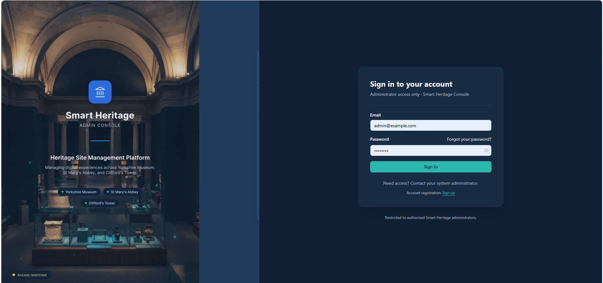

### Dashboard - Admin

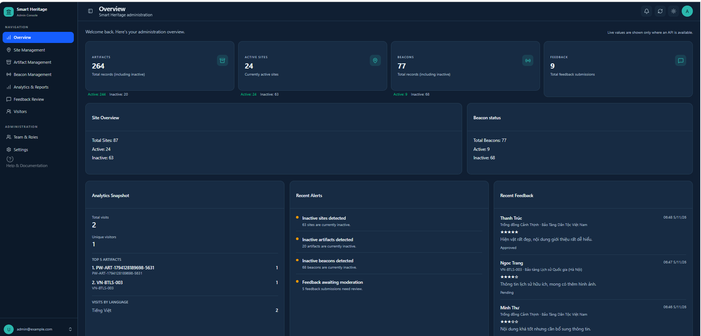

### Dashboard - Overview (Light Mode)

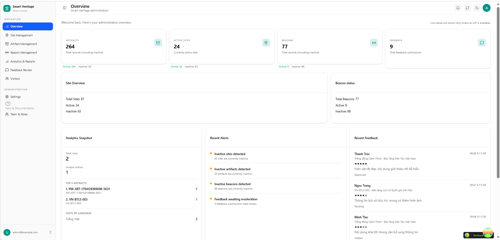

### Dashboard - Site

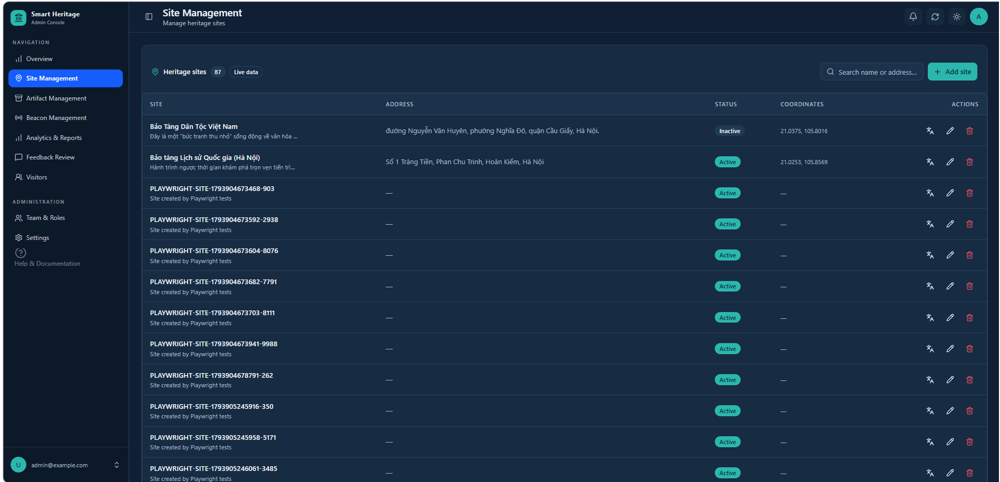

### Dashboard - Artifact

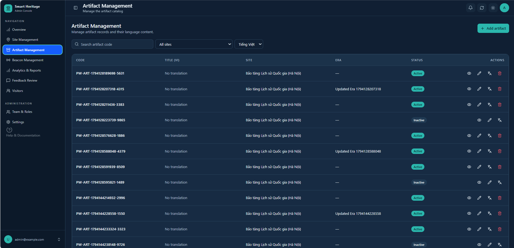

### Dashboard - Beacon

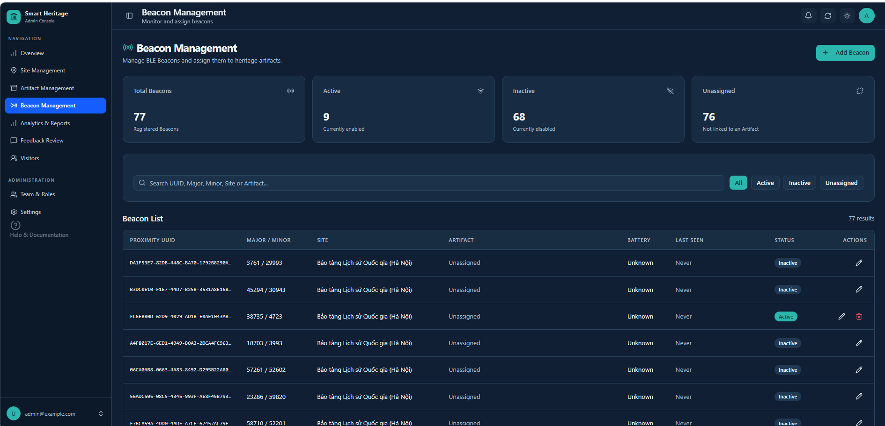

### Dashboard - Analytics and Reports

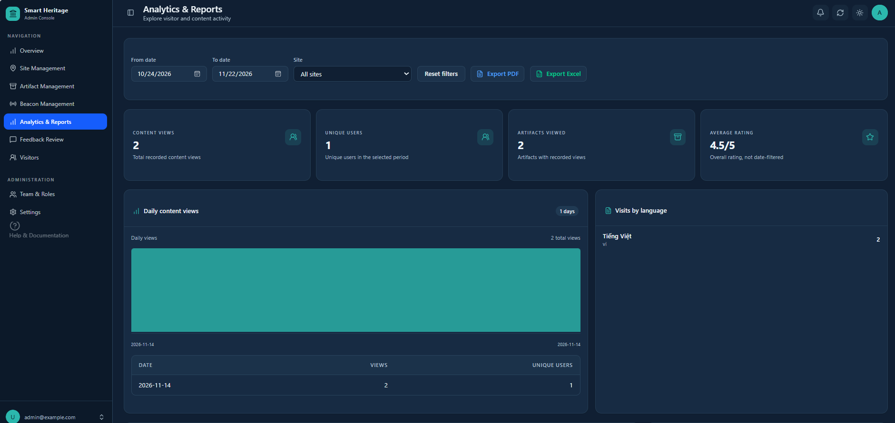

### Dashboard - Feedback review

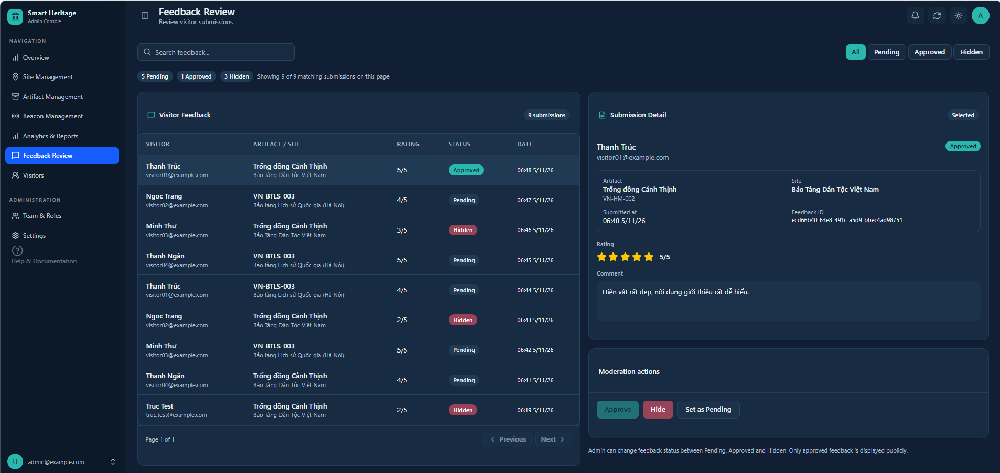

### Dashboard - Visitors

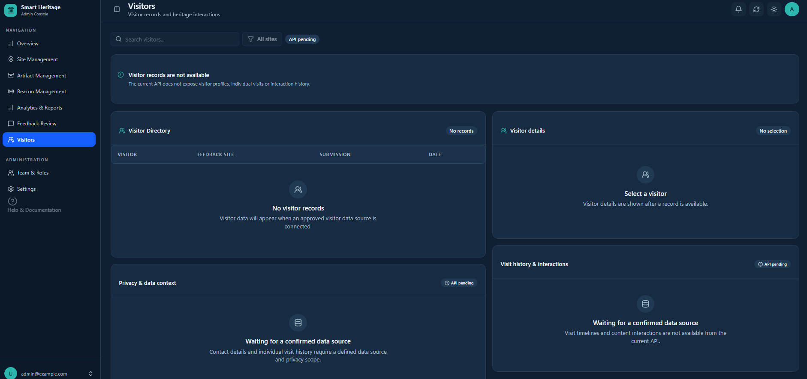

### Dashboard - Team and roles

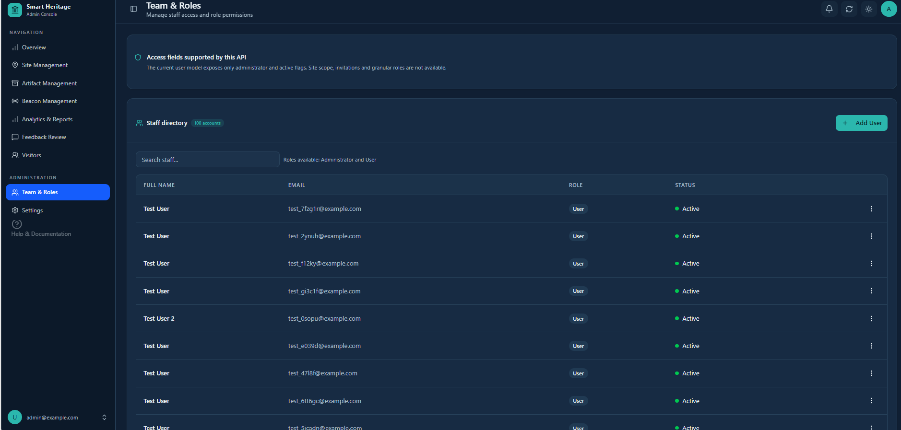

### Notifications
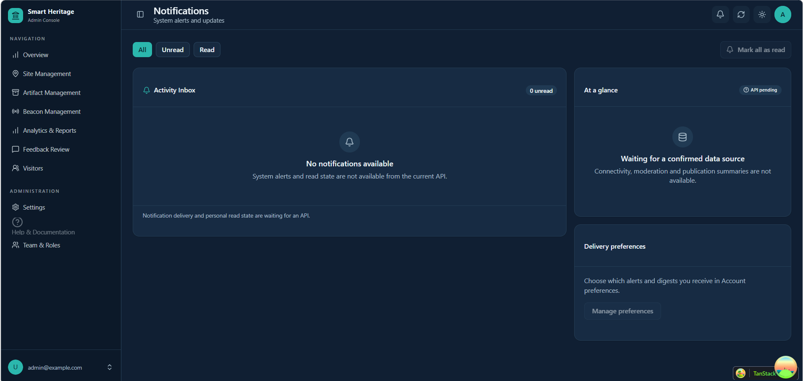

### Dashboard - Account
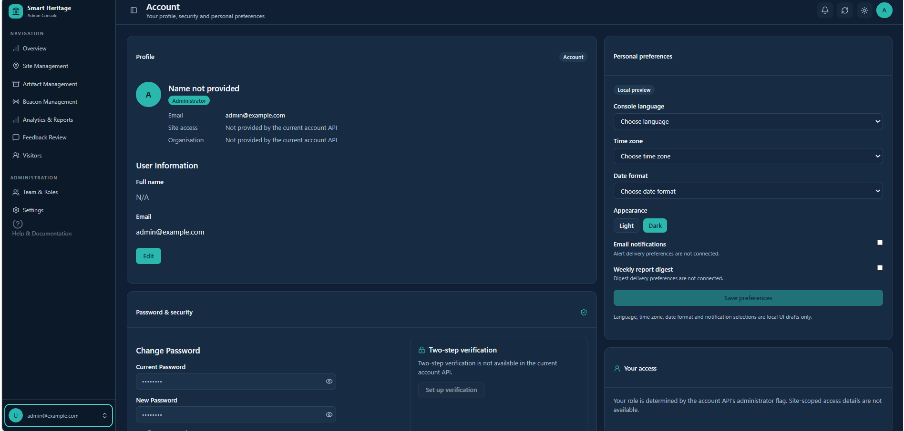

### Dashboard - Settings

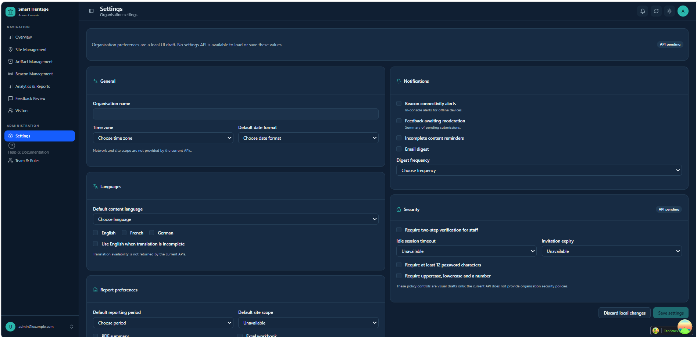

### Interactive API Documentation

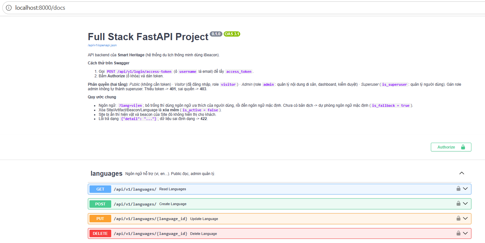

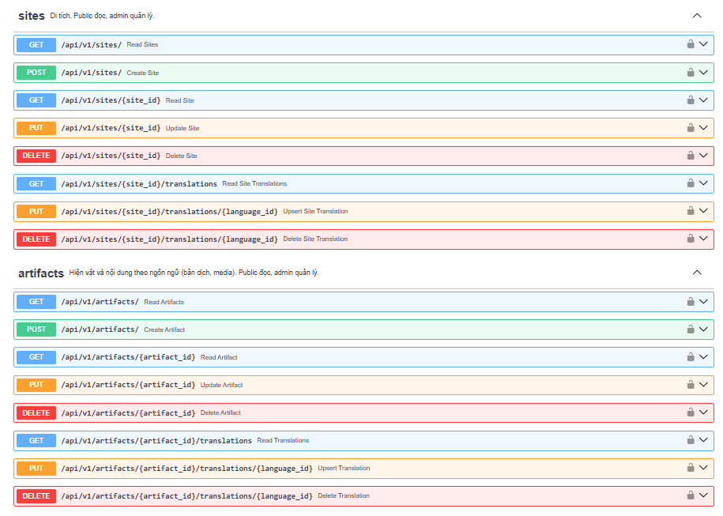

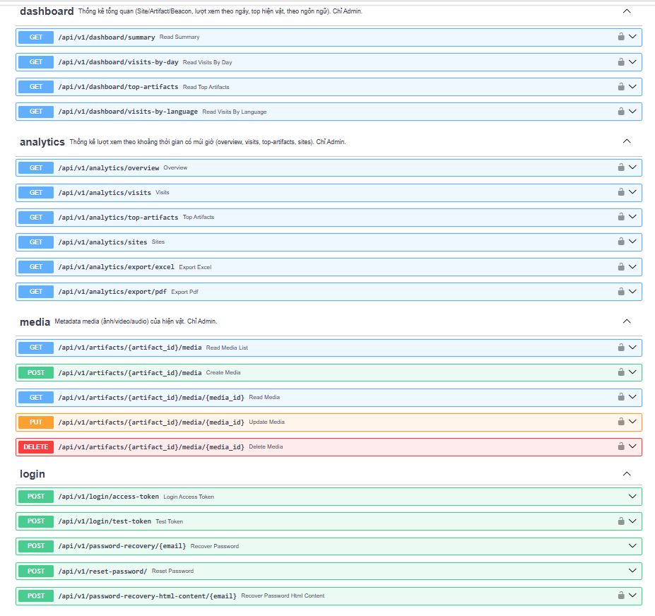

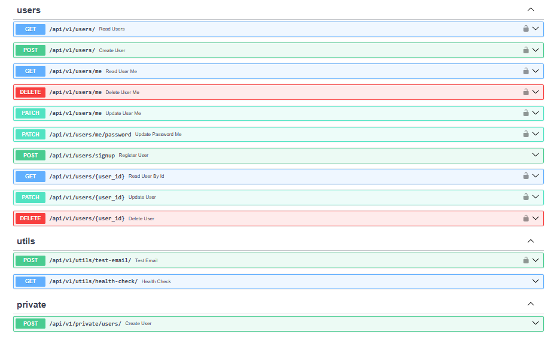

## Quick Start (Local)

Requirements: Docker Desktop running Linux containers, Docker Compose v2 with
`watch` support, and at least 2 GB RAM allocated for SQL Server.
Run these commands in **Windows PowerShell**, from the repository root, in order.
Stop if any command fails; do not continue to backend startup until preparation succeeds.

```powershell
# 1. Create local settings only if they do not already exist.
if (-not (Test-Path -LiteralPath ".env")) {
    Copy-Item -LiteralPath ".env.example" -Destination ".env"
}
notepad .env
```

`.env` is not committed. Review `DB_PASSWORD`, `SECRET_KEY`, `FIRST_SUPERUSER`
and `FIRST_SUPERUSER_PASSWORD`, then save and close the editor before continuing.

```powershell
# 2. Start SQL Server and the supporting services, then create the empty database.
docker compose up -d --wait db mailpit proxy
if ($LASTEXITCODE -ne 0) { throw "Supporting services failed to start." }
docker compose run --rm db-init
if ($LASTEXITCODE -ne 0) { throw "Database creation failed." }

# 3. Build the backend image with the current code and migrations, then prepare the database.
docker compose build backend
if ($LASTEXITCODE -ne 0) { throw "Backend build failed." }
docker compose run --rm backend bash scripts/prestart.sh
if ($LASTEXITCODE -ne 0) { throw "Database preparation failed; do not start the backend." }

# 4. Start the backend and watch its configured source paths.
docker compose watch backend
```

Preparation is a separate step: run it once on a new database and again after
pulling new migrations, before starting the backend. Repeat the build and
prestart commands above so the preparation container uses the new migrations.
`db-init` only creates the empty database `app`; it does not create tables or users.
`prestart.sh` checks database readiness, applies migrations, then creates missing
roles, languages and the first superuser. Starting FastAPI alone does none of this.

On a new database, look for these preparation log messages (prefixes and revision
IDs vary):

```text
Database is ready
Running upgrade ... -> ...
Creating initial data
Initial data created
```

If the database is already at the latest revision, there may be no `Running upgrade`
messages. Preparation should still finish successfully with `Initial data created`.
Sample heritage sites, artifacts and media are not included in this preparation;
see [sample data instructions](backend/README.md#sample-smart-heritage-data).

Open <http://localhost:8000> and log in using `FIRST_SUPERUSER` as the email and
`FIRST_SUPERUSER_PASSWORD` as the password from `.env`. These values create the
first account during preparation; changing the password in `.env` later does not
reset an existing account's password.

Local services:

| Service              | URL / Address                                   |
| -------------------- | ----------------------------------------------- |
| Web admin and API    | http://localhost:8000                           |
| API docs (Swagger)   | http://localhost:8000/docs                      |
| Mailpit (test email) | http://localhost:8025                           |
| Traefik dashboard    | http://localhost:8090                           |
| SQL Server           | `localhost,14330` (user `sa`, database `app`)   |

SQL Server uses port **14330** on your machine (container port 1433), so it does not clash with a
SQL Server that may already be installed locally. The database password is `DB_PASSWORD` in `.env`.
To inspect the database, connect with a client such as DBeaver or Azure Data Studio.

When testing with a real phone, use the LAN IP of your computer (for example `http://192.168.x.x:8000`).
The Android emulator reaches your computer at `http://10.0.2.2:8000`.

### Troubleshooting: preparation was skipped

If login fails and backend logs report missing tables (for example, `Invalid object
name 'user'`), the empty database may not have been prepared. The
`/api/v1/utils/health-check/` endpoint can still return `true`; it does not check
the schema or the first superuser. Stop the backend watch command with Ctrl+C,
repeat the build and prestart commands in step 3, and only after they succeed run
`docker compose watch backend` again. Keep the existing `.env` and database volume.

## Backend Development

Backend docs: [backend/README.md](./backend/README.md).

To run backend tests in a disposable Docker stack from the repository root:

```bash
bash scripts/test.sh
```

This requires Docker Compose v2+, Bash and OpenSSL. It uses a separate test
project/database and never the development stack or its database volume.
See the [isolated test setup](./backend/README.md#isolated-docker-test-stack)
for lifecycle, cleanup and coverage details.

The database must exist before running the separate preparation step.
Docker Compose uses `db-init` to create the empty local database; on Azure SQL
Database, create the database in the Azure portal before configuring `DATABASE_URL`.
`backend/scripts/prestart.sh` checks the existing target database, then runs
migrations and initial data setup. It never connects to `master` or creates a
database. Backend startup only starts the application; it does not run preparation.

## Frontend Development

Frontend docs: [frontend/README.md](./frontend/README.md).

## Development

General development docs: [development.md](./development.md).

This includes the local FastAPI and Vite workflow, Docker Compose services, `.env` configuration, and more.

## Team Workflow

- Do not push directly to `main`. Create a branch per task (`feature/task-name`) and open a Pull Request.
- CI (GitHub Actions) must pass before merging.

## Release Notes

Check the file [release-notes.md](./release-notes.md).

## License

This project is based on the Full Stack FastAPI Template, licensed under the terms of the MIT license.
